*This project has been created as part of the 42 curriculum by aisfi, nguerrab.*

# push_swap

> Sort a stack of integers using a second stack and a tiny instruction set, printing the shortest list of operations you can.

> **Status in one line:** the program builds and sorts correctly in its default/`--medium`/`--complex` modes for random inputs, but `--simple` (and the low-disorder branch of the adaptive mode) is **broken by a one-line bug**, there is **no Makefile**, **no `--bench` mode**, and the error message is `ERROR` instead of `Error`. See [§6 Bugs](#6-bugs-and-errors-found) and [§9 Status](#9-general-status-of-the-project).

All findings in this document were checked by compiling the sources and running them (details in [§6.4 How this was verified](#64-how-this-was-verified)).

---

## Table of contents

1. [Description](#1-description)
2. [Instructions (build and run)](#2-instructions-build-and-run)
3. [How the program works](#3-how-the-program-works)
4. [File management](#4-file-management)
5. [Function relation diagram](#5-function-relation-diagram)
6. [Bugs and errors found](#6-bugs-and-errors-found)
7. [Things to improve](#7-things-to-improve)
8. [Algorithms, rationale and complexity](#8-algorithms-rationale-and-complexity)
9. [General status of the project](#9-general-status-of-the-project)
10. [Contributions](#10-contributions)
11. [Resources and AI usage](#11-resources-and-ai-usage)

---

## 1. Description

`push_swap` receives a list of distinct integers (the first one is the **top** of stack `a`) and prints, one per line on `stdout`, a sequence of *Push_swap language* operations that sorts `a` in ascending order (smallest on top) with `b` empty at the end.

**Rules of the game (from the subject)**

| Op | Effect |
|----|--------|
| `sa` / `sb` / `ss` | swap the top two elements of a / b / both |
| `pa` | move the top of `b` onto `a` |
| `pb` | move the top of `a` onto `b` |
| `ra` / `rb` / `rr` | rotate up: the first element becomes the last |
| `rra` / `rrb` / `rrr` | reverse rotate: the last element becomes the first |

**Subject requirements** (Push_swap v1.2): four strategies selectable at runtime (`--simple` O(n²), `--medium` O(n√n), `--complex` O(n log n), `--adaptive` default, chosen from the *disorder* metric), optional `--bench` report on `stderr`, `Error\n` on `stderr` for invalid input, and the performance targets below.

| Input size | pass | good | excellent |
|-----------:|-----:|-----:|----------:|
| 100 random numbers | < 2000 ops | < 1500 | < 700 |
| 500 random numbers | < 12000 ops | < 8000 | < 5500 |

**Disorder metric** = (number of pairs `i<j` with `a[i] > a[j]`) / (total pairs), a value in `[0, 1]`. It is computed once, *before* any move.

---

## 2. Instructions (build and run)

### 2.1 Build

**There is no Makefile in the delivered archive**, so the project cannot be built with `make` as the subject requires. Until one is added, compile by hand:

```sh
cc -Wall -Wextra -o push_swap main.c push_swap.c disorder.c src/*.c algo/*.c
```

> With the mandatory `-Werror` the build **fails** today: `algo/radix_sort_lsd.c:36: unused variable 'value'`. Delete that declaration (see [§6](#6-bugs-and-errors-found), bug B3) and use the full flags:
>
> ```sh
> cc -Wall -Wextra -Werror -o push_swap main.c push_swap.c disorder.c src/*.c algo/*.c
> ```

A ready-to-use Makefile that satisfies the subject (`NAME`, `all`, `clean`, `fclean`, `re`, no relink) is given in [§7.1](#71-add-a-makefile).

### 2.2 Run

```sh
./push_swap 2 1 3 6 5 8            # default = adaptive
./push_swap --simple 5 4 3 2 1     # force a strategy (must be the FIRST argument)
./push_swap "4 67 3 87 23"         # a single quoted argument with several numbers also works
./push_swap 3 2 3                  # duplicate -> "ERROR" on stderr, exit code 1
./push_swap                        # no argument -> prints nothing, exit code 0
```

Count and verify the result (a `checker` program is **not** part of the delivered files; use the school's binary or the tiny Python checker in [§6.4](#64-how-this-was-verified)):

```sh
ARG=$(shuf -i 0-9999 -n 100 | tr '\n' ' ')
./push_swap $ARG | wc -l
./push_swap $ARG | ./checker_linux $ARG      # -> OK
```

Accepted input: optional `+`/`-` sign, decimal digits, range `INT_MIN..INT_MAX`, tokens separated by spaces (either as separate arguments or inside one quoted argument), no duplicates.

---

## 3. How the program works

### 3.1 Data structure: two circular buffers

Each stack is a `t_stack` backed by a fixed-size `int` array used as a **ring buffer**:

```c
typedef struct s_stack {
    int *arr;       // storage, allocated once with capacity = number of inputs
    int  capacity;  // never changes
    int  head;      // physical index of the top element
    int  size;      // number of elements currently stored
} t_stack;

typedef struct s_ctr { t_stack *a; t_stack *b; } t_ctr;   // the "container" of both stacks
```

Logical element `i` (0 = top) lives at `arr[(head + i) % capacity]`. This makes every operation O(1) with no shifting of memory:

| Operation | Implementation (all in `stack_*` helpers) |
|-----------|---------------|
| push | `head = (head-1+cap) % cap; arr[head] = v; size++` |
| pop | `v = arr[head]; head = (head+1) % cap; size--` |
| rotate up (`ra`) | copy top to the slot just past the end, `head++` |
| reverse rotate (`rra`) | `head--`, put the old last element there |
| swap | exchange `arr[head]` and `arr[head+1]` |

A move that would do nothing (e.g. `ra` on a stack with fewer than 2 elements, `pa` with empty `b`) is **not printed**, so the output never contains useless no-ops.

Both stacks are allocated with the *same* capacity (the number of input values), so `a + b` can never overflow.

### 3.2 Program flow (`main`)

1. `argc < 2` → return silently (no output).
2. `check_flag`: if `argv[1]` is exactly `--simple`, `--medium`, `--complex` or `--adaptive`, store `flag = 1..4`, otherwise `flag = 0` (treated like adaptive). It also **pre-counts** how many numbers the arguments contain (`find`/`inputs`) to size the stacks.
3. No number found, or flag without numbers → `error()`.
4. `ctr_int(count)` allocates the two stacks.
5. `ifelse` → `add_to` → `valid_add` parses and validates every token (`parse_number` does overflow-safe parsing in a `long long`, `repetition` rejects duplicates, `add_number` stores into `a`). Any problem frees memory and calls `error()`.
6. `disorder(a)` is measured, then `push_swap(s, flag, disorder)` picks the strategy.
7. Free everything, return 0.

### 3.3 Strategy selection (`push_swap.c`)

```
flag 1  (--simple)   -> select_sort   O(n²)
flag 2  (--medium)   -> chunk_sort    O(n√n)
flag 3  (--complex)  -> radix_sort    O(n log n)
flag 0/4 (default / --adaptive):
        disorder <  0.2        -> select_sort
        0.2 <= disorder < 0.5  -> chunk_sort
        disorder >= 0.5        -> radix_sort
```

### 3.4 The three sorting algorithms

All three first convert values to **ranks** (`ranking`/`ft_index`: the value `v` becomes its position `0..n-1` in sorted order), which lets the algorithms work with compact integers whatever the input range (negatives included).

**Selection sort (`algo/select_sort.c`)** — `O(n²)`
Repeat `n` times: find the minimum of `a` (`min_rotation`), bring it to the top using the shorter of `ra`s or `rra`s (`move_to_min`), `pb` it. When `a` is empty, `pa` everything back; because the minima were pushed in increasing order, the last pushed (the largest) is at the top of `b`, so popping reverses the order and `a` ends up ascending.

**Chunk sort (`algo/chunk_sort.c`)** — `O(n√n)`
- Split the rank range into `k = ⌈√n⌉` chunks of `⌈n/k⌉` ranks (`sqre`, `chunk_while`).
- For each chunk in increasing order, scan `a`: `pb` every element whose rank is in the chunk, `ra` otherwise (`push_chunk`). It stops early if `a` becomes sorted while `b` is still empty.
- Then `sort_b`: repeatedly locate the maximum of `b` (`fft_max`), rotate `b` the shorter way (`rb`/`rrb`) and `pa` it. Because the chunks were stacked in increasing order, the current maximum is always inside the most recent chunk, so only about `√n` rotations are needed per element.

**Radix sort LSD (`algo/radix_sort_lsd.c`)** — `O(n log n)`
For every bit `0..⌈log₂ n⌉-1` of the rank: look at the top of `a`; if the bit is 1 `ra`, else `pb`; then `pa` the whole of `b` back. After the last bit the stack is sorted; the loop also stops early if `a` is already sorted after a pass.

### 3.5 Measured performance

Measured with a Python checker over random permutations (10 runs per row, values in `[-5000, 5000)`); every run was validated by replaying the operations on both stacks.

| Strategy | n = 100 (min / avg / max) | n = 500 (min / avg / max) | Correct? |
|----------|--------------------------|---------------------------|----------|
| `--simple` | 1356 / 1479 / 1633 | 30803 / 31962 / 33547 | **5 of 10 runs KO** at both sizes (bug B1) |
| `--medium` | 728 / 773 / 815 | 7897 / 8092 / 8342 | OK |
| `--complex` | 1084 / 1084 / 1084 | 6784 / 6784 / 6784 | OK |
| default / `--adaptive` | 745 / 923 / 1084 | 6784 / 7268 / 8126 | OK on random input |

Scaling of operations on single random inputs (shows the complexity classes empirically):

| n | simple | medium | complex |
|--:|-------:|-------:|--------:|
| 100 | 1 421 | 778 | 1 084 |
| 200 | 5 811 | 2 120 | 2 468 |
| 500 | 32 347 | 8 024 | 6 784 |
| 1 000 | 129 317 | 22 423 | 15 068 |
| 2 000 | 505 546 | 61 660 | 33 136 |

Doubling `n` multiplies simple by ≈ 4× (n²), medium by ≈ 2.8× (n√n = 2.83×) and complex by ≈ 2.2× (n log n). Against the subject's thresholds, the default mode **passes** both targets and reaches **"good" for 100** numbers on every run, but not "excellent" (< 700 / < 5500); for 500 numbers the maximum observed (8126) is slightly above the "good" line (8000).

---

## 4. File management

### 4.1 Tree

```
push_swap/
├── main.c               entry point, flag detection, argument pre-count, add_to
├── push_swap.c          strategy dispatcher (flag + disorder -> algorithm)
├── disorder.c           disorder metric (0.0 .. 1.0)
├── header/
│   └── push_swap.h      structs t_stack / t_ctr and every prototype
├── algo/
│   ├── select_sort.c    O(n²)       (min_rotation, move_to_min, select_sort)
│   ├── chunk_sort.c     O(n√n)      (sort_b, push_chunk, chunk_while, chunk_sort)
│   └── radix_sort_lsd.c O(n log n)  (radix_u, radix_sort)
└── src/
    ├── stack_U.c        ctr_int, stack_init, stack_shift_up/down, stack_is_sorted
    ├── stack_U2.c       stack_swap, stack_free, stack_pop, stack_push, rrr
    ├── op_stack.c       pa, pb, sa, sb, ss
    ├── op_stack_r.c     ra, rb, rr, rra, rrb
    ├── main_U.c         ft_memcmp, isallnum, isnum, ft_strlen, error
    ├── main_U2.c        repetition, print_arr, ft_putnbr, ifelse
    ├── bubble_U.c       argument parser: skip_spaces, parse_number, add_number, valid_add
    └── chunk_U.c        sqre, ranking, fft_max, ft_index
```

15 source files, 1108 lines in total. **Missing:** `Makefile`, `libft` (not required), `checker` (bonus), `README.md` (this file).

### 4.2 Responsibility of each file

| File | Layer | Role |
|------|-------|------|
| `main.c` | entry | `main`, `check_flag` (flag + count), `find`/`inputs` (count numbers in argv), `add_to` (loop that validates and stores each argument) |
| `push_swap.c` | control | `push_swap()`: choose algorithm |
| `disorder.c` | metric | `disorder()`: O(n²) pair count, returns `float` |
| `header/push_swap.h` | interface | types and prototypes (one header for everything) |
| `algo/*.c` | algorithms | the three sorting strategies |
| `src/stack_U.c`, `src/stack_U2.c` | data structure | ring-buffer primitives (no printing) |
| `src/op_stack.c`, `src/op_stack_r.c` | operations | the 11 Push_swap instructions; **the only place that prints** an operation (`write(1, …)`) |
| `src/bubble_U.c` | parsing | tokeniser/validator for numbers |
| `src/main_U.c`, `src/main_U2.c` | helpers | tiny libc replacements and `error()` |
| `src/chunk_U.c` | helpers | ranking and index lookup used by chunk/radix |

> **Naming note.** Several file names do not describe their content (`bubble_U.c` contains the *parser*, not a bubble sort; `chunk_U.c` holds shared ranking helpers used by radix too; `main_U*.c` are utility libraries). The `_U` suffix is not explained anywhere. See [§7.6](#76-code-hygiene-and-readability).

### 4.3 Memory management

- Only `malloc` calls: the two `t_stack` structs and their arrays (`ctr_int`/`stack_init`), the container `t_ctr`, and the rank array in `ranking`.
- Everything is released in `main` on success; `add_to`/`ifelse` free on invalid input.
- Allowed external functions are respected: only `write`, `malloc`, `free`, `exit` are used. No global variables. No `libft`.
- Known leak: see bug B8.

---

## 5. Function relation diagram

Arrows mean "calls". Colours: blue = entry/control, orange = algorithms, green = operations that print, grey = data-structure primitives, purple = parsing/utilities.

```mermaid
flowchart TD
    subgraph ENTRY["main.c / push_swap.c / disorder.c"]
        main["main"]
        check_flag["check_flag"]
        inputs["inputs"]
        find["find"]
        push_swap["push_swap<br/>(dispatcher)"]
        disorder["disorder"]
    end

    subgraph PARSE["parsing & utils (main_U*.c, bubble_U.c)"]
        ifelse["ifelse"]
        add_to["add_to"]
        valid_add["valid_add"]
        skip_spaces["skip_spaces"]
        parse_number["parse_number"]
        add_number["add_number"]
        repetition["repetition"]
        isallnum["isallnum"]
        isnum["isnum"]
        ft_memcmp["ft_memcmp"]
        ft_strlen["ft_strlen"]
        error["error<br/>(write 2 + exit)"]
    end

    subgraph ALGO["algo/"]
        select_sort["select_sort"]
        min_rotation["min_rotation"]
        move_to_min["move_to_min"]
        chunk_sort["chunk_sort"]
        chunk_while["chunk_while"]
        push_chunk["push_chunk"]
        sort_b["sort_b"]
        radix_sort["radix_sort"]
        radix_u["radix_u"]
    end

    subgraph HELP["chunk_U.c"]
        sqre["sqre"]
        ranking["ranking"]
        ft_index["ft_index"]
        fft_max["fft_max"]
    end

    subgraph OPS["op_stack.c / op_stack_r.c / stack_U2.c (print the move)"]
        pa["pa"]
        pb["pb"]
        sa["sa"]
        sb["sb"]
        ss["ss"]
        ra["ra"]
        rb["rb"]
        rr["rr"]
        rra["rra"]
        rrb["rrb"]
        rrr["rrr"]
    end

    subgraph STACK["stack_U.c / stack_U2.c (no printing)"]
        ctr_int["ctr_int"]
        stack_init["stack_init"]
        stack_free["stack_free"]
        stack_push["stack_push"]
        stack_pop["stack_pop"]
        stack_swap["stack_swap"]
        stack_shift_up["stack_shift_up"]
        stack_shift_down["stack_shift_down"]
        stack_is_sorted["stack_is_sorted"]
    end

    main --> check_flag
    check_flag --> ft_memcmp --> ft_strlen
    check_flag --> ft_strlen
    check_flag --> inputs --> find
    main --> error
    main --> ctr_int --> stack_init
    ctr_int --> stack_free
    main --> ifelse
    ifelse --> add_to
    ifelse --> error
    add_to --> isallnum
    add_to --> isnum
    add_to --> valid_add
    add_to --> stack_free
    valid_add --> skip_spaces
    valid_add --> parse_number
    valid_add --> add_number --> repetition
    main --> disorder
    main --> push_swap
    main --> stack_free
    push_swap --> select_sort
    push_swap --> chunk_sort
    push_swap --> radix_sort

    select_sort --> min_rotation
    select_sort --> move_to_min
    select_sort --> pb
    select_sort --> pa
    move_to_min --> ra
    move_to_min --> rra

    chunk_sort --> stack_is_sorted
    chunk_sort --> ranking
    chunk_sort --> sqre
    chunk_sort --> chunk_while --> push_chunk
    chunk_sort --> sort_b
    chunk_sort --> error
    push_chunk --> ft_index
    push_chunk --> pb
    push_chunk --> ra
    push_chunk --> stack_is_sorted
    sort_b --> fft_max
    sort_b --> rb
    sort_b --> rrb
    sort_b --> pa

    radix_sort --> ranking
    radix_sort --> radix_u
    radix_sort --> pa
    radix_sort --> stack_is_sorted
    radix_u --> ft_index
    radix_u --> ra
    radix_u --> pb

    pa --> stack_pop
    pa --> stack_push
    pb --> stack_pop
    pb --> stack_push
    sa --> stack_swap
    sb --> stack_swap
    ss --> stack_swap
    ra --> stack_shift_up
    rb --> stack_shift_up
    rr --> stack_shift_up
    rra --> stack_shift_down
    rrb --> stack_shift_down
    rrr --> stack_shift_down

    classDef entry fill:#dbeafe,stroke:#2563eb,color:#111;
    classDef algo fill:#ffedd5,stroke:#ea580c,color:#111;
    classDef ops fill:#dcfce7,stroke:#16a34a,color:#111;
    classDef stack fill:#e5e7eb,stroke:#6b7280,color:#111;
    classDef parse fill:#f3e8ff,stroke:#9333ea,color:#111;
    class main,check_flag,inputs,find,push_swap,disorder entry;
    class select_sort,min_rotation,move_to_min,chunk_sort,chunk_while,push_chunk,sort_b,radix_sort,radix_u,sqre,ranking,ft_index,fft_max algo;
    class pa,pb,sa,sb,ss,ra,rb,rr,rra,rrb,rrr ops;
    class ctr_int,stack_init,stack_free,stack_push,stack_pop,stack_swap,stack_shift_up,stack_shift_down,stack_is_sorted stack;
    class ifelse,add_to,valid_add,skip_spaces,parse_number,add_number,repetition,isallnum,isnum,ft_memcmp,ft_strlen,error parse;
```



**Layering at a glance**

```
main ─► parse/validate ─► disorder ─► push_swap (dispatcher)
                                          │
                  ┌───────────────────────┼───────────────────────┐
              select_sort             chunk_sort              radix_sort
                  └───────────────┬───────┴───────────────────────┘
                                  ▼
                 pa pb sa sb ss ra rb rr rra rrb rrr   (print one line each)
                                  ▼
          stack_pop / stack_push / stack_swap / stack_shift_up / stack_shift_down
                                  ▼
                       t_stack ring buffer (arr, head, size, capacity)
```

Unused (dead) functions: `print_arr`, `ft_putnbr`, `ss`, `rr`, `rrr` and `sa`/`sb` are defined but never called by any algorithm (`print_arr` and `ft_putnbr` are debug leftovers).

---

## 6. Bugs and errors found

Severity: 🔴 breaks correctness or a mandatory requirement · 🟠 spec deviation · 🟡 robustness / quality.

### 6.1 Critical and mandatory-requirement failures

| ID | Sev. | Where | Problem | Evidence |
|----|------|-------|---------|----------|
| **B1** | 🔴 | `algo/select_sort.c`, `min_rotation` line `r = s->head;` | The index of the minimum is initialised with the **physical** ring-buffer index `head` instead of the **logical** index `0`. When the minimum is already on top and `head != 0` (which is the case from the 2nd iteration on) the function returns a wrong position, so `move_to_min` rotates a non-minimum to the top and pushes it. `b` is then not ordered and the final stack is **not sorted**. | `--simple` fails on 5/10 random inputs of size 100 and 500; `./push_swap 0 1 2` (default mode) outputs 7 operations that leave the stack unsorted; all the near-sorted inputs tested in default mode (disorder < 0.2) were wrong (see §6.4). **Fix: `r = 0;`.** After this one-line change, all 120 permutations of n=5 and all random tests pass. |
| **B2** | 🟠 | `src/main_U.c`, `error()` | Prints `"ERROR\n"`; the subject requires exactly `"Error\n"` (stderr). | `./push_swap abc` → `ERROR` |
| **B3** | 🔴 | `algo/radix_sort_lsd.c`, line 36 | Unused variable `int value;` → the mandatory flags `-Wall -Wextra -Werror` make compilation **fail**. | `error: unused variable 'value' [-Werror=unused-variable]` |
| **B4** | 🔴 | repository root | **No `Makefile`** (rules `$(NAME)`, `all`, `clean`, `fclean`, `re` are required; it must not relink). | file list |
| **B5** | 🔴 | whole program | **`--bench` is not implemented**: `./push_swap --bench 3 2 1` → `ERROR`. The disorder percentage, strategy name + complexity, total ops and the per-operation counters on `stderr` are required. No operation counter exists in the code. | run |
| **B6** | 🟠 | `main.c`, `check_flag` | Only `argv[1]` is inspected for a flag. The subject's own example `./push_swap --bench --adaptive $ARG` (two flags) and flags placed after other options are rejected. | run |
| **B7** | 🟠 | `select_sort.c`, `radix_sort_lsd.c` | Already-sorted (and single-element) input is **not** short-circuited: `select_sort` always does `n` `pb` + `n` `pa`; `radix_sort` always runs at least one full pass. `./push_swap 1` prints `pb` `pa`; a sorted list of 10 prints 30 ops (default) or 65 (`--complex`). The expected output is **empty**. (`chunk_sort` does check and prints 0.) | run |
| **B8** | 🟡 | `algo/chunk_sort.c`, `chunk_sort` | When `chunk_while` returns 1 (the stack became sorted by rotation) the function returns **without `free(rk)`**. Valgrind: `40 bytes in 1 blocks are definitely lost` for `--medium 5 6 7 8 9 0 1 2 3 4`. Memory leaks are a 0 in the evaluation. | valgrind |
| **B9** | 🟡 | `disorder.c` | For 1 element `total_pairs == 0` → `0.0f/0.0f = NaN`. All comparisons with NaN are false so the adaptive mode falls into the `else` branch (radix) by accident. Return 0 when `total_pairs == 0`. | code reading + B7 output |

### 6.2 Design and robustness issues

| ID | Sev. | Where | Problem |
|----|------|-------|---------|
| B10 | 🟡 | `radix_sort`, `chunk_sort` | If `ranking()` fails (`malloc`), `radix_sort` silently returns an unsorted stack with exit code 0, while `chunk_sort` calls `error()` (which `exit`s without freeing the stacks). Inconsistent failure handling. |
| B11 | 🟡 | `ranking`, `ft_index`, `radix_u`, `chunk_while` | Algorithms use `capacity` as "the number of elements" and `ranking` reads `arr[0..size)` ignoring `head`. This is only correct because they run when `head == 0` and `size == capacity`. Any later reuse (e.g. calling a sort on a partially filled stack) silently breaks. |
| B12 | 🟡 | `main.c` `find`/`inputs` vs `src/bubble_U.c` `valid_add` | The input is parsed **twice with two different hand-written tokenisers** (one to count, one to validate). They agree today (ASan/valgrind clean on every case tried), but the count only works because every valid token contains a digit; any future change to one parser can overflow `a->arr` (`add_number` has no capacity check). |
| B13 | 🟡 | `ranking`/`ft_index` | `ft_index` is a linear search called for every element on every pass → CPU cost O(n² log n) for radix. Fine for ≤ 5 000 numbers (measured 0.37 s for `--complex` at n = 5000; 0.77 s for `--medium`) but needlessly slow. |
| B14 | 🟡 | `op_stack*.c` | Every operation does its own `write(1, …)` system call → up to ~30 000 syscalls for large inputs. |
| B15 | 🟡 | all algorithms | `ss`, `rr`, `rrr` are implemented but **never used**, so the instruction count is higher than necessary (e.g. `ra` + `rb` pairs are never merged). |
| B16 | 🟡 | `ft_memcmp` | Non-standard semantics: returns `-1` (not the byte difference) and compares lengths first via `ft_strlen`; calling it `ft_memcmp` is misleading (it is really `str_equals`). |
| B17 | 🟡 | `isallnum`/`isnum` | `isnum` returns 1 if *any* digit exists, so strings like `-` or `+ 5` rely on `valid_add` to reject them later. Correct but the two pre-checks are redundant with `valid_add`. |

### 6.3 Style / norm

`norminette` (current release) reports errors only in `header/push_swap.h`: lines 70–71 (4 messages) use spaces instead of tabs on the duplicated prototypes `chunk_sort` and `radix_sort`; every `.c` file passes. Other things that are not norm errors but should be cleaned: duplicated prototype of `chunk_sort` (lines 50 and 70), a trailing tab on line 54, leftover comments (`//valid`, `//valide`, `//3amrha fial`), debug functions (`print_arr`, `ft_putnbr`), and the misleading file names listed in [§4.2](#42-responsibility-of-each-file).

### 6.4 How this was verified

- **Compilation:** `cc -Wall -Wextra -Werror …` (fails, B3) and without `-Werror` (one warning).
- **Correctness:** a Python script replays the printed operations on two lists and checks `a == sorted(input)` and `b == []`. Tested: *all* permutations for n = 1…5 in every mode, and 10 random inputs for n = 100 and n = 500 in every mode.
- **Low-disorder inputs (default mode, n = 100):** near-sorted lists built by swapping a few close neighbours were **wrong in 5/5 runs for every disorder value below 0.2** (disorder 0.00–0.06), and still wrong in 2/5 at ≈ 0.20, confirming B1 impacts the adaptive regime.
- **Root-cause confirmation:** after changing only `r = s->head;` to `r = 0;` in a scratch copy, all n ≤ 5 permutations and all random n = 100/500 runs passed in every mode.
- **Memory:** valgrind (`--leak-check=full`) on 7 representative inputs (clean) plus the rotated-sorted input for B8 (leak); ASan/UBSan build on random inputs (clean).
- **Error handling:** empty string, non-numeric, duplicates, `INT_MAX+1`, `INT_MIN-1`, lone sign, flag without number, flag in the wrong position, no argument.

Limits of this verification: no `checker_linux` binary was available (the Python replay was used instead), and `--bench` could not be tested because it does not exist.

---

## 7. Things to improve

Ordered by value for the evaluation.

### 7.1 Add a Makefile

```make
NAME    = push_swap
CC      = cc
CFLAGS  = -Wall -Wextra -Werror
SRCS    = main.c push_swap.c disorder.c \
          src/stack_U.c src/stack_U2.c src/op_stack.c src/op_stack_r.c \
          src/main_U.c src/main_U2.c src/bubble_U.c src/chunk_U.c \
          algo/select_sort.c algo/chunk_sort.c algo/radix_sort_lsd.c
OBJS    = $(SRCS:.c=.o)

all: $(NAME)

$(NAME): $(OBJS)
	$(CC) $(CFLAGS) $(OBJS) -o $(NAME)

%.o: %.c header/push_swap.h
	$(CC) $(CFLAGS) -c $< -o $@

clean:
	rm -f $(OBJS)

fclean: clean
	rm -f $(NAME)

re: fclean all

.PHONY: all clean fclean re
```

### 7.2 Fix the correctness / compliance bugs (30 minutes of work)

1. `min_rotation`: `r = 0;` (B1).
2. Delete `int value;` in `radix_sort` (B3).
3. `error()`: write `"Error\n"`, 6 bytes (B2).
4. `disorder()`: `if (total_pairs == 0) return (0);` (B9).
5. Early exit at the start of `push_swap()`: `if (stack_is_sorted(s->a)) return ;` — fixes B7 for all algorithms at once.
6. `chunk_sort`: `free(rk)` before the early `return` (B8).

### 7.3 Implement `--bench`

- Add a counters struct (or an `int ops[11]` array) to `t_ctr` and increment it inside each `pa … rrr`; **no globals** are allowed, so it must travel inside `t_ctr`.
- Parse flags in a loop over leading `--…` arguments (so `--bench --adaptive` works), keeping `strategy` and `bench` as separate variables.
- After sorting, print to **stderr**: disorder as `%` with two decimals, `strategy / complexity`, total ops, then the 11 counters (format in the subject, §VI.5.1). A hand-written `ft_putnbr`/`ft_putfloat` is enough since `printf` is forbidden.

### 7.4 Reduce the operation count

Current averages are 923 (n=100) and 7268 (n=500) with the default mode. To reach the "excellent" tiers (< 700 / < 5500):

- **Chunk sort, smarter `b` placement:** while pushing a chunk, send the *lower half* of the chunk with `pb` + `rb` so that `b` is already roughly sorted; the final `sort_b` then needs far fewer rotations. This alone usually brings n=500 below 5500.
- **Rank-based `sort_b`:** pick between `rb`/`rrb` by comparing with the next two candidates, and use `sb` when the top two of `b` are the next two maxima.
- **Merge rotations:** when both stacks need to rotate in the same direction use `rr`/`rrr` instead of two lines (`ss`, `rr`, `rrr` are free to use and currently dead code).
- **Radix:** use a *base-4 or base-8* radix, or stop sorting bits that are already in order, to reduce passes; also use the *both-directions* trick (put 0-bits into `b` and rotate `b` when useful).
- **Near-sorted input (low disorder):** replace the quadratic selection with an *insertion-like* strategy that first extracts the longest increasing subsequence and only moves the out-of-place elements; operation count becomes proportional to the disorder rather than to n². It is still within the required O(n²) bound for that regime.
- **Tiny inputs:** hard-code optimal sequences for n = 2, 3 (and a small search for 4–5). Today n = 3 uses ≈ 8 ops on average, the optimum is ≤ 2.

### 7.5 Make the adaptive mode a real design

At present "adaptive" is a **dispatcher** onto the three existing algorithms. The subject asks for a custom adaptive algorithm of the learners' own design with documented rationale. Suggestions:
- keep the 0.2 / 0.5 thresholds (they come from the subject) but document in [§8](#8-algorithms-rationale-and-complexity) *why* each internal technique fits its regime;
- in the low-disorder regime use the insertion / LIS idea above instead of plain selection;
- in the high regime consider radix with the improvements above.

### 7.6 Code hygiene and readability

- Rename files after their content: `bubble_U.c` → `parse_args.c`, `chunk_U.c` → `rank_utils.c`, `main_U.c`/`main_U2.c` → `utils.c`/`utils2.c`, `stack_U*.c` → `stack.c`/`stack_ops.c`, `op_stack*.c` → `ops_push_swap.c`/`ops_rotate.c`.
- Remove dead code (`print_arr`, `ft_putnbr`, duplicate prototype) and comments such as `//valid`.
- Replace `ft_memcmp(argv[1], "--simple", ft_strlen(argv[1]))` by a clearly named `ft_streq`.
- Parse the numbers **once** (single tokeniser that fills a dynamic array) and drop `find`/`inputs` (B12).
- Pass `n` (stack size) explicitly to algorithms instead of reading `capacity`, and make `ranking` honour `head` (B11).
- Buffer the output (build the whole operation list in a char buffer or list, flush once) (B14).
- Add `libft` optionally, or at least keep the helper functions in one library-like file.
- Write a `checker` (the bonus) — it is easy because the stack code already exists: read lines from stdin, call the same operations without printing, print `OK`/`KO`. Note that the bonus is only assessed when the mandatory part is perfect.
- Add a small test script (`tests/run.sh`) that loops over sizes and compares op counts to the thresholds.

---

## 8. Algorithms, rationale and complexity

> The subject requires the README to document the thresholds, the techniques per regime and a complexity argument in the Push_swap operation model. Cost below = **number of operations printed**.

### 8.1 Adaptive thresholds and why

| Regime | Disorder | Technique in the code | Class required by the subject |
|--------|----------|----------------------|-------------------------------|
| Low | `< 0.2` | selection sort with shortest rotation | O(n²) |
| Medium | `0.2 ≤ d < 0.5` | chunk sort with ⌈√n⌉ chunks | O(n√n) |
| High | `d ≥ 0.5` | LSD radix sort on ranks | O(n log n) |

The thresholds 0.2 / 0.5 are fixed by the subject. A random permutation has expected disorder 0.5, so random inputs normally land on the radix side (or just below it, on the chunk side); nearly-sorted inputs land on the selection side. *Rationale:* quadratic algorithms are acceptable only when the list is already close to sorted (few elements to move), the √n-chunk method is a good compromise for partially ordered input, and radix is the best asymptotic choice when ordering information is absent. In the current implementation the low regime is **not** actually exploiting near-sortedness (selection sort does ~n²/4 rotations whatever the order) — see §7.4/7.5.

### 8.2 Complexity arguments (upper bounds, operations as the cost)

Let `n` be the number of integers.

**Selection sort — time O(n²), space O(n).**
Each of the `n` iterations performs at most `⌊size(a)/2⌋` rotations (the code takes the shorter direction) plus one `pb`; then `n` `pa`. Total ≤ Σ(i/2) + 2n ≈ n²/4 + 2n = O(n²). Empirically: 1 421 ops at n=100, 32 347 at n=500 (≈ 4× per doubling).

**Chunk sort — time O(n√n), space O(n).**
- *Distribution phase:* there are `k = ⌈√n⌉` chunks. Extracting one chunk requires one pass over (at most) the remaining part of `a`, i.e. ≤ n `ra` + chunk-size `pb`. Total ≤ k·n + n = O(n√n).
- *Collection phase:* `b` is a ring in which the chunks sit in the order they were pushed, the highest chunk being at the top. The maximum is always located inside the highest remaining chunk, which occupies a contiguous arc of ≤ ⌈n/k⌉ = O(√n) cells next to the top; rotating the shorter way costs O(√n) per element, followed by one `pa`. Total O(n√n).
- Space: two arrays of size n plus the rank array: O(n).
Empirically the operation count grows by ≈ 2.75× when n doubles (n√n predicts 2.83×).

**Radix sort LSD — time O(n log n), space O(n).**
Ranks lie in `[0, n-1]`, so `⌈log₂ n⌉` bits suffice. Each pass performs exactly `n` operations of type `ra`/`pb` and then `|b|` `pa` (≤ n): ≤ 2n per bit. Total ≤ 2n⌈log₂ n⌉ = O(n log n). Empirically 1 084 ops at n=100 (bound 1 400), 6 784 at n=500 (bound 9 000).

**Adaptive.** Its cost is the cost of the chosen branch, so worst-case it is bounded by the maximum of the three regimes **given the stated disorder range**: ≤ O(n²) when d < 0.2, O(n√n) for 0.2 ≤ d < 0.5, O(n log n) for d ≥ 0.5. The disorder computation itself is O(n²) CPU time but performs **no** Push_swap operation, so it does not enter the operation-count model.

**Non-operation costs** (CPU, not asked by the subject): `ranking` O(n²), `ft_index` O(n) per call.

---

## 9. General status of the project

**Overall (rough estimate): ≈ 60–65 % — a working core (parser, ring-buffer stacks, chunk and radix algorithms) with several mandatory deliverables missing or broken. Not ready to be submitted as is.**

### 9.1 Checklist against the subject

| Requirement | State | Notes |
|-------------|:-----:|-------|
| Written in C, only `write/malloc/free/exit` | ✅ | No libc sorting, no `printf` |
| No global variables | ✅ | |
| Norm | 🟡 | only `push_swap.h` lines 70–71 (spaces/tabs) |
| Compiles with `-Wall -Wextra -Werror` | ❌ | unused variable (B3) |
| `Makefile` (`NAME all clean fclean re`, no relink) | ❌ | missing (B4) |
| No memory leaks | 🟡 | one leak path in `chunk_sort` (B8); everything else clean |
| No crash on valid/invalid input | ✅ | ASan/UBSan/valgrind clean in all tested cases |
| Parsing: ints, sign, overflow, duplicates, quoted multi-number arg | ✅ | |
| Error message `Error\n` on stderr | ❌ | prints `ERROR` (B2) |
| No arguments → no output | ✅ | |
| Output = operations separated by `\n` | ✅ | |
| Sorts correctly: `--medium`, `--complex` | ✅ | all n ≤ 5 permutations + 100/500 random |
| Sorts correctly: `--simple` | ❌ | KO on ~50 % of random inputs (B1) |
| Sorts correctly: default/`--adaptive` | 🟡 | OK for disorder ≥ ≈0.2 (all random input), **KO for near-sorted input** (B1) |
| Four strategies embedded, selectable by flag | 🟡 | present; flag must be `argv[1]`; adaptive is only a dispatcher (B6, §7.5) |
| Disorder metric computed before the moves | ✅ | NaN for n=1 (B9) |
| `--bench` mode (stderr report) | ❌ | not implemented (B5) |
| Empty output for already-sorted input | ❌ | B7 (except `--medium`) |
| Performance, 100 numbers (< 2000 / 1500 / 700) | ✅ | pass + good (avg 923), not excellent |
| Performance, 500 numbers (< 12000 / 8000 / 5500) | 🟡 | pass; "good" on average (7268) but max 8126 > 8000; not excellent |
| README with required sections, both logins on 1st line | ✅ | this file (logins taken from the 42 file headers: `aisfi`, `nguerrab`) |
| Both learners' contributions documented | 🟡 | see §10 — inferred from file headers, **please confirm** |
| Bonus `checker` | ❌ | not started (only assessed if the mandatory part is perfect) |

### 9.2 Suggested order of work

1. Apply the six one-line fixes of [§7.2](#72-fix-the-correctness--compliance-bugs-30-minutes-of-work).
2. Add the Makefile ([§7.1](#71-add-a-makefile)).
3. Implement `--bench` and multi-flag parsing ([§7.3](#73-implement---bench)).
4. Improve chunk sort placement in `b` and merge rotations to reach the "good/excellent" tiers ([§7.4](#74-reduce-the-operation-count)).
5. Clean names and dead code ([§7.6](#76-code-hygiene-and-readability)); re-run `norminette`, valgrind, and the evaluator's checker.
6. Optionally write the `checker` bonus.

---

## 10. Contributions

The subject asks the README to state each learner's contribution. The following is **inferred from the `By:` line of each file header** and must be reviewed by the authors:

| Learner | Files authored (header `By:`) |
|---------|------------------------------|
| **aisfi** | `header/push_swap.h`, `disorder.c`, `algo/select_sort.c`, `algo/radix_sort_lsd.c`, `src/stack_U.c`, `src/op_stack.c`, `src/op_stack_r.c` — i.e. ring-buffer stacks, push/rotate operations, selection and radix sorts, disorder metric |
| **nguerrab** | `main.c`, `push_swap.c`, `algo/chunk_sort.c`, `src/main_U.c`, `src/main_U2.c`, `src/bubble_U.c`, `src/chunk_U.c`, `src/stack_U2.c` — i.e. argument parsing/validation, error handling, dispatcher, chunk sort, ranking helpers |

Several files were later edited by the other learner (e.g. `main.c` and `push_swap.c` show `Updated by aisfi`), so both learners must be able to explain every part of the code during the defence.

---

## 11. Resources and AI usage

**Classic references**

- Donald E. Knuth, *The Art of Computer Programming, vol. 3: Sorting and Searching* (radix and selection sort).
- Cormen, Leiserson, Rivest, Stein, *Introduction to Algorithms* — chapters on sorting in linear time (radix sort) and on analysing algorithms.
- Wikipedia: [Radix sort](https://en.wikipedia.org/wiki/Radix_sort), [Selection sort](https://en.wikipedia.org/wiki/Selection_sort), [Circular buffer](https://en.wikipedia.org/wiki/Circular_buffer), [Inversion (discrete mathematics)](https://en.wikipedia.org/wiki/Inversion_(discrete_mathematics)) (the disorder metric is the normalised inversion count), [Big O notation](https://en.wikipedia.org/wiki/Big_O_notation).
- The 42 *Norm* and the *Push_swap* subject (v1.2).
- Valgrind and AddressSanitizer documentation for leak and memory-error checking.

**AI usage (for this document)**

The sections of this README (explanation, file map, function diagram, bug list, improvement list, status) were produced by an AI assistant (Claude) from the delivered source files and the subject PDF. The AI compiled the code, ran it under valgrind/ASan, and replayed the operations with a custom Python checker to confirm each bug before listing it. The authors must read, test and be able to explain everything they keep; the contribution table in §10 in particular is an inference that needs their confirmation. If AI was also used to write parts of the source code, this section must be completed with *which tasks and which files* it was used for, as the subject demands.
